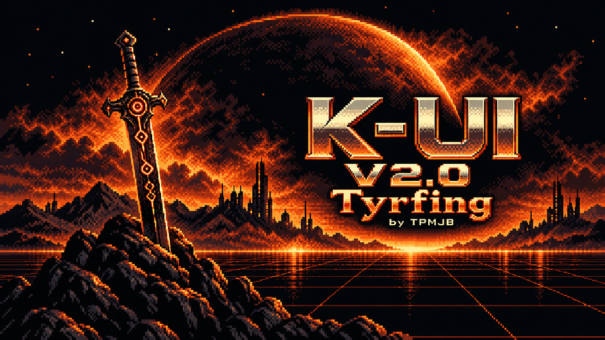
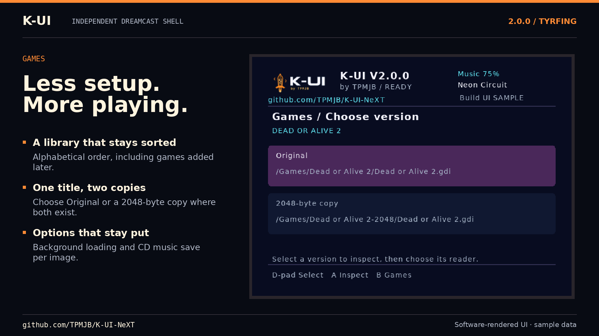
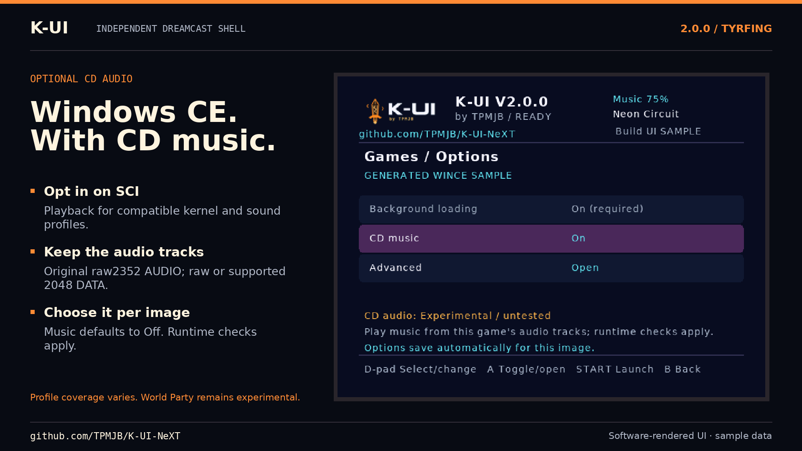
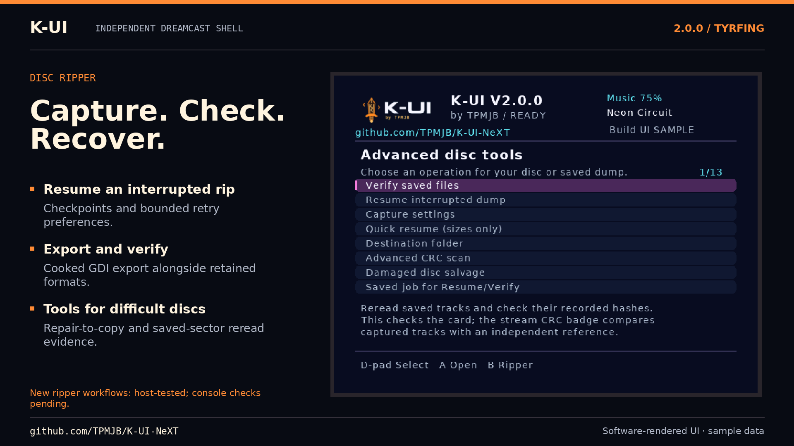
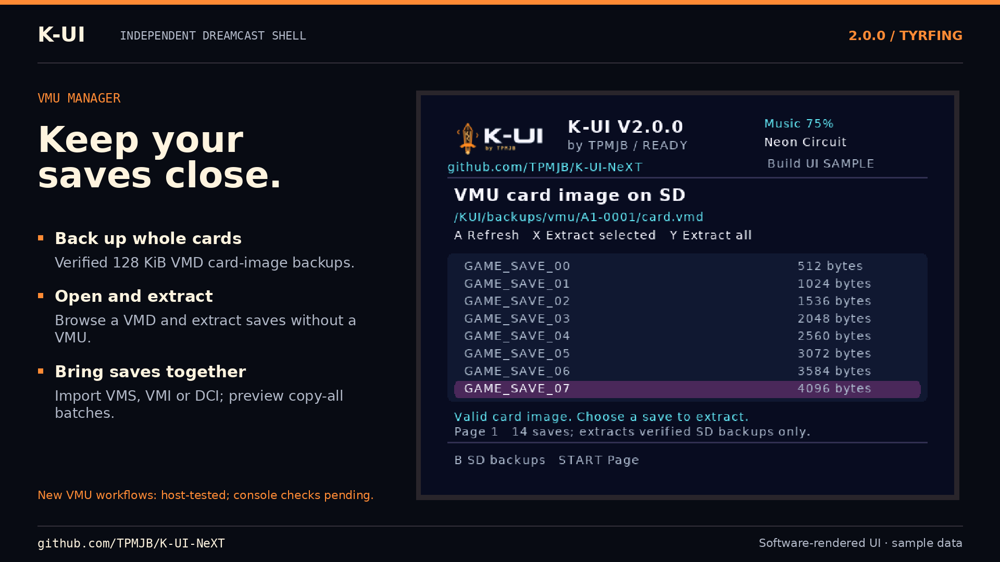
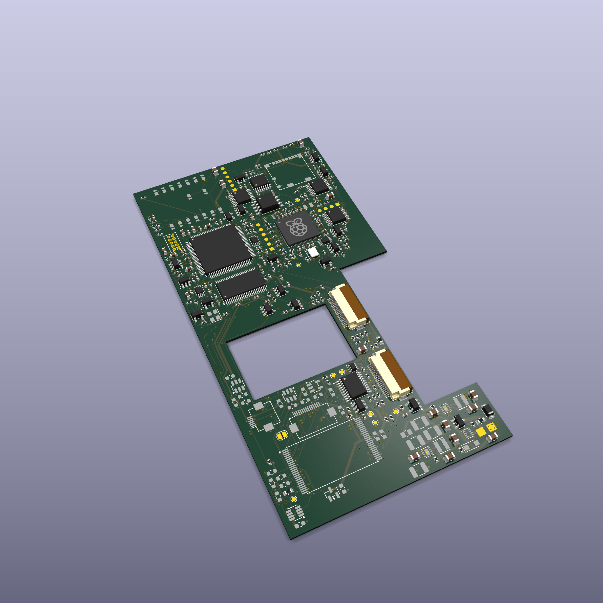

<!-- SPDX-License-Identifier: GPL-3.0-only -->
# K-UI 2.0.0 “Tyrfing” — release notes since 1.7.5

**Tyrfing brings the work since 1.7.5 into one public update:** a more usable
Games library, native compatibility and FMV improvements, optional SCI CD
music, expanded disc formats and ripping tools, more VMU workflows, and new
orange pixel artwork. This cumulative changelog includes the intervening
1.8.5 work, which did not receive a separate public announcement.

K-UI is an independent Dreamcast environment built on upstream KallistiOS,
with its own shell, disc capture engine and game loader. The original GD-ROM
stays installed. exFAT remains the primary working-card setup; FAT32 is also
supported. Existing compatible independent K-UI boot CDs and game dumps remain
usable. Follow the [installation guide](release-v2.0.md), and update the
complete matching `KUI` folder together.

[Release downloads](https://github.com/TPMJB/K-UI-NeXT/releases/tag/v2.0.0) ·
[Screenshots and posting images](release-v2.0-image-index.md) ·
[Reddit/forum drafts](release-v2.0-announcements.md) ·
[Optional development support](https://ko-fi.com/tpmjb)

## Release previews

These are release feature cards using host-rendered interface examples, not
console photographs or gameplay captures. The
[image index](release-v2.0-image-index.md) includes the full gallery, raw UI
renders, image origins and posting captions.

| Games library | Optional SCI CD music |
| --- | --- |
|  |  |

| Disc preservation | VMU tools |
| --- | --- |
|  |  |

## Games: compatibility and a better library

- **Native reader placement:** moving the reader and its private stack below
  the IP image avoids startup-stack collisions. Sonic Adventure, Grandia II
  and Skies of Arcadia have working owner hardware reports. Earlier GD-command
  corrections also brought Power Stone 1 and 2 to fluid gameplay.
- **Skies and Time Stalkers:** retain the accepted drive-status and mounted-image
  disc-check behavior, rather than reporting the physical boot CD's state to
  the game. RC15 restored the accepted configuration omitted from RC14.
- **Evolution and Evolution II:** retain the accepted SCI resume/cancellation
  correction associated with the owner's improved opening FMV results.
- **Always alphabetical:** ordering remains consistent across pages, cached
  visits and later additions to the card. The last folder and highlighted
  title are remembered by name.
- **More responsive browsing:** recent folders stay in a bounded RAM catalogue.
  Rows appear before artwork; only the selected game's cover loads. The first
  scan of a large collection can still take several seconds.
- **Original/2048 picker:** safely matched original and converted sibling
  folders appear as one title with a version choice. Equivalent GDI/CUE
  descriptors are grouped only after checking complete track maps.
- **Saved launch choices:** reader, CD music, encoding and related advanced
  options belong to the selected image. Original and 2048 copies can keep
  separate settings. Compatible legacy JSON presets migrate when both new
  settings slots are absent; originals are preserved and unsupported or
  oversized legacy collections are explicitly refused.
- **Preparation tools:** Check executable, detected defaults, a temporary
  unsaved baseline and durable pre-handoff launch reports aid troubleshooting.
  A preparation check does not execute a game or certify every sector.

The batch [2048-byte GDI converter](gdi-2048-test.md) creates separate copies,
keeps raw audio, preserves originals and reports conversions, skips and errors.
Conversion is optional; it does not create compatibility by itself or replace
an archival raw dump. See [library behavior](games-library.md) and
[launch options](games-launch-options.md).

## More image formats, with explicit boundaries

| Image | Games support in 2.0.0 |
| --- | --- |
| GDI | Supported original raw and cooked 2048-byte DATA; raw audio retained |
| ISO | Supported complete Dreamcast data sessions with valid boot metadata |
| BIN/CUE | Supported shared/separate BINARY track and session layouts |
| CDI | Supported DiscJuggler v2, v3 and v3.5 layouts |
| Standalone BIN/IMG | Supported raw Mode 1 / Mode 2 Form 1 data layouts |
| ZSO | Experimental separate LZ4/LZO1X native SCI Standard readers; explicit codec choice |
| CSO / CHD | Supplied PC importer required; no resident decoder |

Native CD images expose Plain/Scrambled encoding. Descriptors, sector geometry,
offsets and launch-map bounds are checked rather than inferred from extensions.
ZSO's bounded first implementation has no background, CE or CD music combination
and still needs console acceptance. See [formats](games-formats.md) and
[ZSO scope](games-zso.md).

## Optional CD music from SCI storage

**CD music is opt-in and defaults to Off.** Windows CE runs through the
background SCI reader. The optional music path adds checked adapters
established from these US runtimes:

| Adapter established from | Hardware evidence and scope |
| --- | --- |
| Armada | Boot/gameplay and music reports; documented audio/FMV limits remain |
| Bust-A-Move 4 | Successful music report and recorded native starts |
| Worms Armageddon | Music, converted2048 cold boots and improved input responsiveness |
| Worms World Party | Scoped successful owner report; broader support remains Experimental |

Runtime identity, sound interfaces and memory contracts determine admission.
Other images sharing an admitted implementation can be attempted as
Experimental; an audio-track list or familiar title name is insufficient.
Unknown combinations are refused when music is On. With music Off, Games uses
the ordinary CE loading path.

The music worker yields within a bounded work budget and uses checked aligned
RAM copies. In the latest Worms performance test, the owner described the
remaining input delay as almost imperceptible. This is a subjective result
for that tested path, without a zero-overhead or new link-speed claim.

Native CD music retains the Toy Commander/MDK2 runtime bindings and checked
selection for matching implementations. **Toy Commander's intro FMV stutter
remains unresolved**, even where CD music plays. Raw2352 AUDIO is required;
supported DATA can be original raw or converted2048. See
[music admission and evidence](experimental-cdda.md).

## Disc Ripper: more capture and recovery controls

Established raw capture, Stop/Resume, CRC32/SHA-256 verification, Redump/TOSEC
comparisons and separate damaged-disc salvage remain. The cumulative update adds:

- **Output choices:** GDI, BIN/CUE, CSO, historical LZO ZSO, CHDv4 and cooked
  **GDI 2048**. Post-capture exports retain raw source files and are verified
  against them. Allow space for both forms.
- **Jobs and names:** exact saved-job selection for Resume/Verify, destination
  browsing and optional New folder labels. New uses a free name instead of
  replacing a previous capture.
- **Retries and strict checks:** bounded additional retries and optional Mode 1
  framing/EDC/P/Q acquisition checks.
- **Repair to a separate copy:** a matching GD-ROM and validated repeat reads
  precede replacement of supported damaged Mode 1 sectors in new output.
  Originals/evidence remain; unresolved copies stay partial.
- **Saved-sector reread evidence:** bounded repeat-read samples from saved
  tracks, without changing those tracks.
- **Declared single-session CD capture:** explicit opt-in BIN/CUE capture for
  known single-session CD/CD-R/audio CD media. Arbitrary multisession self-boot
  discs are outside this scope.
- **Experimental direct PC destination:** an authenticated Python receiver
  exposes a dedicated FAT32/exFAT volume image through W5500/Wi-Fi. Capture
  writes there directly, without a temporary local-card dump. It is a volume
  image, not an SMB/NFS folder; console adapter acceptance is pending.

A full independent reference match, saved-file consistency and structural
sector checks remain separate results. A partial catalogue match is never
reported as a full-disc match. Compressed export does not imply compressed
Games launch support. New export, recovery, CD and PC paths have host/fault/
filesystem coverage and retain their documented console-test limits. See
[ripper controls](ripper-controls.md), [repair](repair-copy.md) and [PC setup](network-rip.md).

## VMU and system tools

- **Whole-card backup:** verified raw 128 KiB VMD, including an empty formatted VMU.
- **VMD browsing/extraction:** inspect standard raw images and extract one/all
  saves into verified bundles without a connected VMU.
- **External save import:** preview supported VMS/VMI/DCI files and stage new
  verified SD bundles. Physical restore is a separate confirmed action. Bare
  VMS data needs a correct short filename; its payload lacks the original VMU name.
- **Copy all between VMUs:** preview the batch, check capacity/conflicts, back
  up source saves first, then verify each copy. A stopped/failed batch reports
  partial completion rather than an all-or-nothing result.
- **System comparison:** compare exact-size card images with two stable reads
  of settings flash or the visible BIOS bank, reporting differences without
  programming either chip.
- **Startup VMU display:** K-UI and the current version appear on the LCD.

Selected-save backup/restore retains its earlier hardware evidence. New VMD,
import, batch-copy and comparison workflows have host/fault/filesystem checks;
broad RC15 game acceptance does not establish every maintenance path.
Full-card restore, format/overwrite, BIOS programming and permanent region
changes are not provided. See [VMU tools](vmu-restore.md), [imports](vmu-import.md),
[bulk copy](vmu-copy-all.md) and [system comparison](system-backups.md).

## Networking, Home and presentation

- XIAO ESP32-C5/C6 Wi-Fi scan/join and saved adapter settings; C5 offers
  2.4/5 GHz band selection, while C6 is 2.4 GHz.
- Adaptive SCI pacing, reconnect after an accepted band change, listener-ready
  FTP startup and bounded wireless frame bursts.
- Compatible card-supplied adapter firmware check/install after confirmation.
  Initial programming/recovery still use USB; firmware is built separately.
- Retained W5500 Ethernet/FTP transfer and connection-close handling.
- Seven new original icon pairs complete the ten-app Home menu, with TV
  legibility refinements. Orange pixel Tyrfing artwork refreshes the runtime,
  header, bootstrap and disc badge.
- Optical STOP at the runtime screen, with idle disc discovery parked until
  an observed media change. Optical apps can spin the drive when needed.

SCI networking needs storage on SCIF because SCI storage owns the same port.
No new radio, Ethernet or storage throughput figure is claimed for 2.0.0.
New wireless timing/update paths retain their own console-acceptance limits.
See [Wi-Fi](wifi.md), [updates](wifi-console-update.md) and [FTP](ftp.md).

The ten apps remain Games, Disc Ripper, VMU Manager, File Manager, Music Player,
GD Play, Memory Test, Network, Diagnostics and Settings. Checked file tools,
music, storage tests, boot/recovery and diagnostics retain their documented
scopes and individual evidence.

## Validation and remaining limits

On **October 15, 2026 (America/Chicago)**, after the priority RC15 console retest,
the owner reported “everything seems to work now” and authorized final 2.0.0
preparation. This accepts the restored native baseline; it does not invent a
complete title/region/peripheral matrix. The
[accepted-fix audit](release-v2.0-accepted-fix-audit.md) explains the RC14
configuration omission and release guards. The
[CDDA artifact audit](release-v2.0-cdda-acceptance-audit.md) records the scope of
earlier feature-binary results.

Release validation covers host tests, disposable FAT32/exFAT images, linked
reader layout/stack/instruction checks, payload inventories, source identity
and checksums. Check the final release's CI status and `build.json` for its
exact build. These checks complement hardware reports, without establishing
universal compatibility.

- Some native FMVs still stall or skip; Toy Commander is a known example.
- CD music remains runtime/title-dependent. Universal CDDA, Mode 2 Form 2 and
  subchannel emulation are not provided. Quake III music is deferred.
- CE requires SCI. IDE/CF is experimental synchronous PIO without physical
  validation; ATA DMA and CE on IDE/SCIF remain future work.
- ext4 is read-only bootstrap support, not runtime app/game-library access.
- Direct ZSO, new ripper recovery/PC/CD paths, newer wireless behavior and new
  maintenance workflows retain individual experimental/acceptance labels.
- Gameplay screenshots, VMU emulation, alternate executable selection,
  additional boot methods and per-game region override remain future work.

## Looking toward version 3

The custom internal G1 microSD / Wi-Fi carrier is designed to retain the
original GD-ROM and has provision for optional BIOS circuitry. Its current
59 × 115 mm design is being developed separately. It is a
**hardware preview**, not a 2.0.0 requirement or a validated shipping accessory.
Getting that board working is the intended milestone for version 3. Its press
render depicts a design in development, without establishing manufacture,
electrical operation, fit or achieved performance. The 2.0.0 software release
continues to use the existing supported setups. The [CAD render notes](../resources/release-v2.0/board/README.md)
identify the exact hardware revision and components without resolved 3D bodies.

New K-UI shell code is GPL-3.0-only except where stated. Separate Wi-Fi firmware
and kwlink are MIT; dependencies retain their original licenses. Corresponding
source, dependency pins and notices accompany packaged releases. See
[source and licensing records](../THIRD_PARTY.md).
