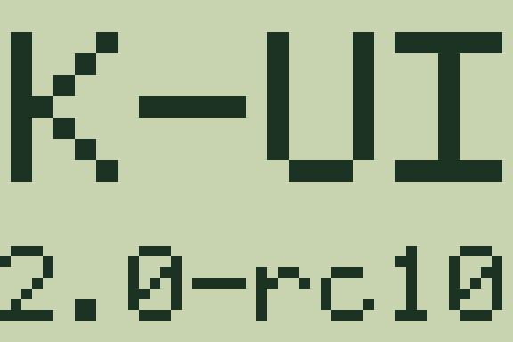

# VMU startup display



K-UI sends this screen once to each attached LCD after its first video frame and the existing bounded disc STOP. Both the CD bootstrap and SD runtime use the version from `KUI_VERSION` automatically. Missing, busy or unsupported LCDs are skipped; there is no retry, completion wait, hotplug polling or VMU save-memory access.

The VMU display is 48×32 monochrome pixels (192 bytes). The K-UI logo occupies 46×14 pixels. The version fits eight characters in a 5×7 font; longer versions use a compact 3×5 font with twelve characters per line, up to two lines. Versions longer than 24 characters end with `+`. Unsupported characters become `?`.

Host checks cover bounds, alignment, orientation, long-version fallback and one submission per attached LCD. Native compilation checks the KOS interfaces. Physical display behavior still needs hardware verification.

Regenerate this preview from the same renderer used on hardware:

```sh
make build/test-vmu-lcd
ASAN_OPTIONS=detect_leaks=0 ./build/test-vmu-lcd --bitmap /tmp/kui-vmu-startup.bin
python3 tools/vmu_lcd_preview.py /tmp/kui-vmu-startup.bin docs/images/vmu-startup.png
```
